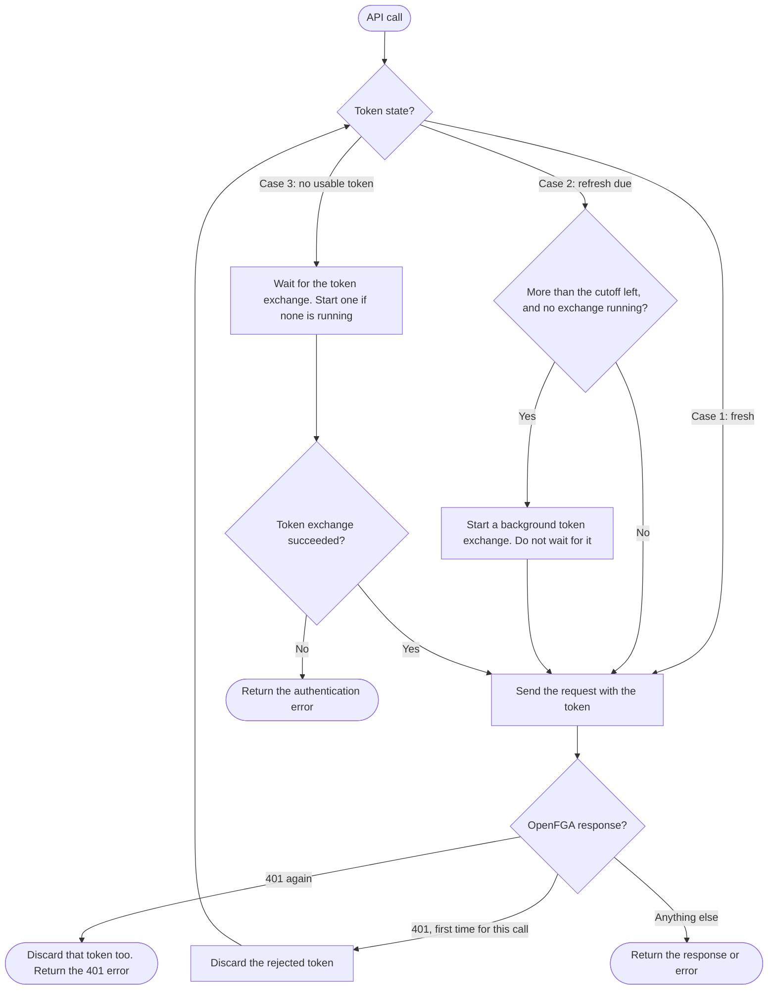
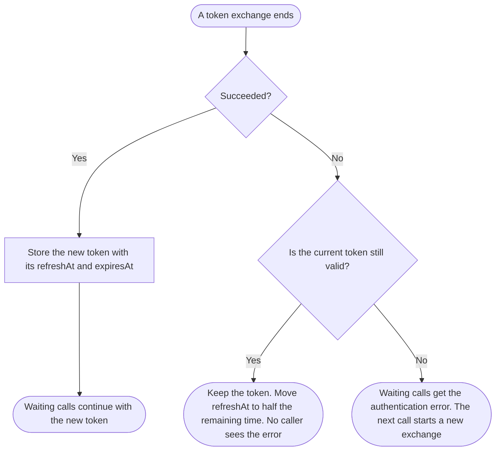

# Meta
[meta]: #meta
- Name: Preemptive background token refresh in the OpenFGA SDKs
- Start Date: 2026-11-24
- Author(s): [@cluelessno1](https://github.com/cluelessno1)
- Status: Draft <!-- Acceptable values: Draft, Approved, On Hold, Superseded -->
- RFC Pull Request: https://github.com/openfga/rfcs/pull/42
- Relevant Issues:
- Supersedes: N/A

# Summary
[summary]: #summary

The OpenFGA SDKs that authenticate with OAuth 2.0 client credentials replace their access token inside an API call, once the token is within a fixed buffer before its expiry. If the token endpoint is unavailable at that moment, the call fails, although the SDK still holds a valid token.

The JS, Go, Python, Java and .NET SDKs would all change in the same way:

- The SDK starts replacing a token at a configurable fraction of its lifetime (default `0.8`, plus jitter). An API call starts this refresh but does not wait for it.
- If a refresh fails, the SDK keeps using the current token until it expires, and tries again at half the remaining time.
- Concurrent calls share a single token request.
- On a `401` from OpenFGA, the SDK discards the token, gets a new one and resends the request once.

The client-credentials configuration gets three optional settings. Existing applications need no code change.

# Definitions
[definitions]: #definitions

- Client credentials: the OAuth 2.0 grant ([RFC 6749, section 4.4](https://datatracker.ietf.org/doc/html/rfc6749#section-4.4)) the SDKs use when they are configured with a client ID and secret. The SDK exchanges them for an access token at the token endpoint of the configured token issuer.
- Token exchange: one call to the token endpoint that returns a new access token, including the SDK's existing retries for that call.
- API call: one request from the SDK to the OpenFGA server, for example Check or Write, including the SDK's retries of that request.
- Lifetime: the `expires_in` value in a token exchange response, in seconds.
- Expiry (`expiresAt`): the time at which the SDK stops using a token. It is the time the token was received plus its lifetime.
- Refresh point (`refreshAt`): the time from which the SDK tries to replace a token that is still valid.
- Background refresh: a token exchange that no API call waits for.
- Case 1, Case 2 and Case 3: the three states an API call can find the token in.
  - Case 1 (fresh): the SDK holds a token and its refresh point has not been reached (`now < refreshAt`).
  - Case 2 (refresh due): the refresh point has been reached and the token has not expired (`refreshAt <= now < expiresAt`).
  - Case 3 (no usable token): the SDK holds no token, or its token has expired (`now >= expiresAt`). This is the case on the first call and after a token is discarded.
- Runway: the time left on the current token when the SDK first tries to replace it. A token endpoint outage that starts and ends within the runway causes no failed API call. If the token is still not replaced when it expires, the next call waits for a new one.

# Motivation
[motivation]: #motivation

## How the SDKs behave today

| | On `main` today |
|---|---|
| When a token is replaced | When an API call finds it inside a fixed buffer before expiry (300 seconds plus up to 300 seconds of jitter in JS, Python, Java and .NET, and a fixed 10 seconds in Go) |
| Where the token exchange runs | Inside that API call, which waits for it |
| If the token exchange fails | The API call fails, even when the cached token is still valid |
| Concurrent calls | They wait for one token exchange. If it fails, Go and Python do not share the failure and each waiting call makes its own token request in turn |
| A `401` from OpenFGA | The SDK returns the error and keeps the token cached until it expires |

## Problems with this behaviour

1. A short outage of the token endpoint fails API calls. Once a token is inside the buffer, every API call needs a new token before it is sent. The token the SDK already holds is still valid, but the SDK does not use it.
2. A fixed buffer does not suit every token lifetime. For a 24-hour token, the SDK first asks for a replacement 5 to 10 minutes before expiry (10 seconds in Go), which leaves little time to recover from a failure. For a 5-minute token, the buffer is at least as long as the token's life, so JS, Python, Java and .NET request a new token on every API call.
3. A rejected token keeps being sent. If OpenFGA answers `401`, the SDK returns the error and reuses the same token on the next call, until the token expires.

## Expected outcome

- A token endpoint outage that starts and ends within the runway causes no failed API call.
- With the defaults, a token is used for at least 80% of its lifetime before it is replaced. So when refreshes succeed, the SDK makes at most 1.25 token requests per lifetime (`1 / 0.8`), for example 5 requests in 4 days for a 24-hour token.
- A `401` caused by a rejected token is retried once with a new token.
- All five SDKs behave the same way and offer the same settings.

# What it is
[what-it-is]: #what-it-is

Application developers who use client credentials are the ones affected. The API token method and the no-credentials method have no token to refresh, so nothing changes for them.

- Application code does not have to change. The defaults apply when the SDK is upgraded.
- The three optional settings sit on each SDK's client-credentials configuration object, next to the client ID and secret. The SDK validates them when it creates the client.
- They cannot be set per request or at the top level of the client configuration. [Alternatives](#alternatives) explains why.

## The settings

| Setting | What it does | Default | Accepted values |
|---|---|---|---|
| `tokenRefreshRatio` | The fraction of a token's lifetime after which the SDK starts trying to replace it | `0.8` | `0.5` to `0.9` |
| `tokenRefreshJitterRatio` | The upper bound of a random fraction added to the ratio, so that clients started together do not all refresh together. `0` turns jitter off | `0.1` | `0` to `0.4` |
| `tokenRefreshCutoffInSec` | The SDK does not start a background refresh during the last this-many seconds of a token's life. `0` turns the cutoff off | `60` | `0` or more |

The ratio plus the sampled jitter is capped at `0.9`. That is why the jitter stops at `0.4`. The lowest ratio is `0.5`, so a larger jitter could never take full effect. With a ratio of `0.9`, jitter has no effect at all.

## The settings in each SDK

| SDK | Ratio | Jitter | Cutoff | Where |
|---|---|---|---|---|
| JS | `tokenRefreshRatio?: number` | `tokenRefreshJitterRatio?: number` | `tokenRefreshCutoffInSec?: number` | `credentials.config` |
| Go | `ClientCredentialsTokenRefreshRatio *float64` | `ClientCredentialsTokenRefreshJitterRatio *float64` | `ClientCredentialsTokenRefreshCutoffInSec *int` | `credentials.Config` |
| Python | `token_refresh_ratio: float \| None` | `token_refresh_jitter_ratio: float \| None` | `token_refresh_cutoff_in_sec: int \| None` | `CredentialConfiguration` |
| Java | `.tokenRefreshRatio(Double)` | `.tokenRefreshJitterRatio(Double)` | `.tokenRefreshCutoffInSec(Integer)` | `ClientCredentials` |
| .NET | `double? TokenRefreshRatio` | `double? TokenRefreshJitterRatio` | `int? TokenRefreshCutoffInSec` | `CredentialsConfig` |
| Spring Boot starter | `openfga.credentials.config.token-refresh-ratio` | `openfga.credentials.config.token-refresh-jitter-ratio` | `openfga.credentials.config.token-refresh-cutoff-in-sec` | `OpenFgaProperties` |

- A setting that is not set uses its default. Go uses pointer fields for this, because in Go a number that is not set reads as `0`, and `0` is a valid value for the jitter and the cutoff.
- A value outside the accepted range makes client creation fail in all five SDKs, with the error that SDK already uses for an invalid configuration value. JS, Go and .NET already validate configuration when the client is created. Java and Python validate it on each API call today, so for them this check comes earlier than their existing ones.
- Python's sync and async clients share the same configuration and follow the same rules.

### Example in JS

The other SDKs take the same three settings, under the names in the table above.

```javascript
const fgaClient = new OpenFgaClient({
  apiUrl: process.env.FGA_API_URL,
  credentials: {
    method: CredentialsMethod.ClientCredentials,
    config: {
      apiTokenIssuer: process.env.FGA_API_TOKEN_ISSUER,
      apiAudience: process.env.FGA_API_AUDIENCE,
      clientId: process.env.FGA_CLIENT_ID,
      clientSecret: process.env.FGA_CLIENT_SECRET,
      tokenRefreshRatio: 0.5,        // optional, default 0.8
      tokenRefreshJitterRatio: 0.05, // optional, default 0.1
      tokenRefreshCutoffInSec: 30,   // optional, default 60
    },
  },
});
```

## Example 1: a 1-hour token and a 9-minute outage

This example uses a ratio of `0.8` and a jitter of `0` to keep the times round, and assumes API calls arrive continuously.

| Time | What happens |
|---|---|
| 12:00:00 | Token A arrives. `expiresAt` is 13:00:00 and `refreshAt` is 12:48:00. Until 12:48 every call uses token A and no token request is made. |
| 12:48:00 | The token endpoint goes down. The next call is sent at once with token A and succeeds. The background refresh fails. 12 minutes remain, so the next attempt is at 12:54:00. |
| 12:54:00 | The endpoint is still down. The next call again uses token A and succeeds. The refresh fails. 6 minutes remain, so the next attempt is at 12:57:00. |
| 12:57:00 | The endpoint is back. The next call uses token A, and the background refresh stores token B (`expiresAt` 13:57:00, `refreshAt` 13:45:00). |

No API call failed or waited. Today, JS, Python, Java and .NET start replacing a token 5 to 10 minutes before it expires, because a random jitter of up to 5 minutes is added to a 5-minute buffer. Their calls would have started failing at some point between 12:50 (longest jitter) and 12:55 (no jitter) and kept failing until 12:57, which is 2 to 7 minutes of failed calls. Go would not have failed here, because its 10-second buffer starts at 12:59:50, after the endpoint was back.

## Example 2: a 5-minute token with the defaults

The ratio puts the refresh point 240 to 270 seconds into the token's life, which leaves 30 to 60 seconds. That is inside the 60-second cutoff, so the SDK does not refresh in the background. It uses the token for the full 5 minutes, and the first call after that waits for a new token. That is one token request every 5 minutes. Today JS, Python, Java and .NET make one on every API call, and Go makes one every 4 minutes 50 seconds.

To give a short-lived token a background refresh, lower the ratio or the cutoff. With a ratio of `0.5`, the refresh point is 150 to 180 seconds in, with 2 to 2.5 minutes left. **_This will be noted explicitly in the README.md of each SDK._**

## Example 3: a token that OpenFGA rejects

A token can be rejected before the SDK considers it expired, for example when the issuer revokes the token or its signing key, or when the server reaches the token's expiry slightly before the SDK does. OpenFGA answers `401`. The SDK discards that token, gets a new one and resends the request once. The caller sees the result of the second attempt.

A `403` is handled as it is today. It means the token is valid but is not allowed to make that request, so a new token would not help. The SDK returns the error and keeps the token.

## Runway by token lifetime

The table assumes the default jitter (0.1) and cutoff (60 seconds). Each range is the time left on the token at its refresh point. Refresh attempts can start until 60 seconds before expiry.

| Token lifetime | Ratio `0.8` (default) | Ratio `0.5` |
| --- | --- | --- |
| 24 hours | 2.4 to 4.8 hours | 9.6 to 12 hours |
| 1 hour | 6 to 12 minutes | 24 to 30 minutes |
| 10 minutes | 1 to 2 minutes | 4 to 5 minutes |
| 5 minutes | None (inside the cutoff) | 2 to 2.5 minutes |

# How it Works
[how-it-works]: #how-it-works

## Token state

The SDK keeps three values together: the access token, `refreshAt` and `expiresAt`. It replaces them as one atomic update, so a reader always gets three values that belong to the same token.

When a token exchange returns a token with lifetime `T`:

- `expiresAt = now + T`.
- `refreshAt = now + T * effectiveRatio`, where `effectiveRatio = min(tokenRefreshRatio + random(0, tokenRefreshJitterRatio), 0.9)` is sampled once per token.
- The lifetime comes only from `expires_in` in the token exchange response. Access tokens are opaque to the SDK and are never decoded.
- `now` is the time the response arrives, so the SDK's expiry is later than the issuer's by the time the response took to arrive. The [`401` handling](#handling-a-401) covers a token that expires on the server first.
- All five SDKs read the time in UTC, never in local time, so a time zone or daylight-saving change does not move the refresh point. If the machine's clock is set back, the SDK can treat an expired token as valid. The [`401` handling](#handling-a-401) covers that.

## On each API call

Every API call finds the token in one of three cases.

| Case | When | What the call does |
|---|---|---|
| Case 1 (fresh) | `now < refreshAt` | Uses the token. |
| Case 2 (refresh due) | `refreshAt <= now < expiresAt` | Uses the token straight away. If more than `tokenRefreshCutoffInSec` seconds are left before `expiresAt` and no token exchange is running, it also starts one in the background. The call does not wait for it. |
| Case 3 (no usable token) | First call, token discarded after a `401`, or `now >= expiresAt` | Waits for a token exchange, starting one if none is running. If the exchange fails, the call fails with the SDK's authentication error, as it does today. |

The SDK does nothing between calls. It has no timer, so an idle client makes no token requests and has nothing to stop when the application exits. Creating a client still makes no network call.



## When a token exchange ends

- It succeeds. The SDK stores the new token with its `refreshAt` and `expiresAt`. Calls that were waiting continue with it.
- It fails and the current token is still valid. The SDK keeps the token and moves `refreshAt` to half the remaining time: `now + (expiresAt - now) / 2`. No caller receives the error. The step is always a halving, whatever `tokenRefreshRatio` is set to. Once `tokenRefreshCutoffInSec` seconds or fewer are left, Case 2 starts no further exchange, so the SDK uses the token until it expires.
- It fails and there is no valid token. Every call waiting on that exchange fails with the SDK's authentication error. The next call starts a new exchange.

A failure is a network error, a timeout, or an error response from the token endpoint after the SDK's usual retries for that request. The SDK treats them all the same way.



## Pseudocode

The rules above as one language-neutral block. [In each runtime](#in-each-runtime) lists how each SDK implements it.

```
// Client credentials only. Kept per client:
//   token     { accessToken, refreshAt, expiresAt }, always replaced as one unit.
//             Empty until the first exchange.
//   exchange  the token exchange that is running, if any

// Runs before every API request.
getAccessToken():
    t = token
    if t is not empty and now < t.refreshAt:        // Case 1: fresh
        return t.accessToken
    if t is not empty and now < t.expiresAt:        // Case 2: refresh due
        // No background refresh in the last tokenRefreshCutoffInSec seconds.
        if t.expiresAt - now > tokenRefreshCutoffInSec:
            startOrJoinExchange()                   // not waited for
        return t.accessToken
    // Case 3: no usable token. The caller gets the new token or the error.
    // A caller that cancels or times out stops only its own wait.
    return wait for startOrJoinExchange()

// At most one exchange per client.
startOrJoinExchange():
    if exchange is empty:
        exchange = start runExchange()
    return exchange

runExchange():
    try:
        // The existing token request and its retries, with a timeout per attempt.
        response = request a token
        storeNewToken(response)
        return response.access_token
    on error:
        backOff()
        fail with the error                         // reaches only waiting calls (Case 3)
    finally:
        exchange = empty

storeNewToken(response):
    T              = response.expires_in
    // Sampled once per token.
    effectiveRatio = min(tokenRefreshRatio + random(0, tokenRefreshJitterRatio), 0.9)
    token = { response.access_token,
              refreshAt: now + T * effectiveRatio,
              expiresAt: now + T }

// After a failed exchange.
backOff():
    t = token
    if t is empty or now >= t.expiresAt:
        return                                      // no valid token to keep
    // Keep the token and try again at half the remaining time.
    // Skipped if the token was replaced or discarded since it was read.
    token = { t.accessToken,
              refreshAt: now + (t.expiresAt - now) / 2,
              expiresAt: t.expiresAt }

// Every API request.
sendToOpenFGA(request):
    used     = getAccessToken()
    response = send(request, used)                  // existing retries for 429 and 5xx unchanged
    if response.status != 401:
        return response

    // OpenFGA rejected the token. Discard it, then get a new one.
    // The call waits for the token exchange (Case 3). If the exchange fails,
    // the call ends here with that authentication error.
    // If another call has already stored a new token, that token is used (Case 1).
    discardToken(used)
    used     = getAccessToken()
    response = send(request, used)                  // sent a second time, once
    if response.status == 401:
        discardToken(used)                          // the new token was rejected too
    return response                                 // a second 401 goes to the caller

discardToken(used):
    // Only the token that was sent. A token another call has stored since is kept.
    if token is not empty and token.accessToken == used:
        token = empty
```

## What the SDK does in each situation

| Situation | What the SDK does |
|---|---|
| A background refresh fails and more than the cutoff remains | Keeps using the current token and tries again at half the remaining time. No API call is affected. |
| A background refresh fails and the cutoff or less remains | Keeps using the current token until it expires. It makes no further background attempt for that token. |
| The token exchange fails in Case 3 | Every call waiting on that exchange fails with the SDK's authentication error, as today. The next call starts a new exchange. |
| OpenFGA returns `401` | Discards the token that was sent, waits for a new one and resends the request once. If the token exchange fails, the call returns the authentication error. If the resent request also gets `401`, the SDK discards the new token too and returns the `401` error. |
| OpenFGA returns `403` or any other error | Keeps the token and handles the error as today. |
| A setting is outside its accepted values | Client creation fails with a validation error. |

## Concurrency rules

All six runtimes (Python has a sync and an async client) follow the same five rules.

1. Reading the token takes no lock. The token, `refreshAt` and `expiresAt` are swapped as one unit. Where a runtime uses a lock, it guards only the record of whether an exchange is running, and the SDK never holds it during a network call.
2. A client runs one token exchange at a time. However many calls arrive at once, the client sends one token request. Calls in Case 2 return at once with the cached token. Calls in Case 3 wait on the same exchange.
3. Every token request has a timeout. Each attempt uses the SDK's configured timeout, or 10 seconds if none is set. The record of the running exchange is always cleared when it ends, so a token endpoint that never answers cannot block later exchanges.
4. One caller giving up does not stop the exchange. If several calls are waiting for a token exchange and one of them is cancelled or times out, only that call stops waiting. The exchange continues and the other calls get its result.
5. Background errors stay inside the SDK. They do not surface as unhandled promise rejections or unobserved task exceptions, and the process can exit without the client being closed.

## In each runtime

| Runtime | How the background refresh runs | How waiting calls share the exchange |
|---|---|---|
| JS | The shared promise is started without being awaited, with an error handler attached in the same tick | Waiting calls await the same promise |
| Go | One goroutine, on a context detached from every caller and with its own timeout | Waiting calls wait on a channel that closes when the exchange ends, and on their own request context |
| Java | The JDK HTTP client's asynchronous send, with no new executor or thread. The call that triggered it receives an already completed future | One in-flight `CompletableFuture`. Each waiting call gets a copy, so cancelling the copy does not cancel the exchange |
| Python (async) | An `asyncio` task that the client keeps a reference to | Waiting calls await the task through `asyncio.shield` |
| Python (sync) | One short-lived daemon thread | A `Future` that waiting threads join outside the lock. In Case 3, if no exchange is running, the first caller runs it on its own thread |
| .NET | The shared task, started and observed so that a failure is not an unobserved exception | One in-flight `Task` that runs with `CancellationToken.None`. A caller's token cancels only its own wait |

In Go, `Token()` on the token source keeps its signature, and the transport calls a context-aware variant so that a request's context can end that request's wait. Java adds no executor, because `OpenFgaClient` is not `AutoCloseable` and a non-daemon thread would keep the JVM from exiting. The JS token code calls the SDK's own request helper, so it does not depend on the HTTP library underneath.

Closing or disposing the client while a refresh is running is safe in Python (async) and .NET. Python cancels and awaits the task before it closes the HTTP session, and .NET observes and ignores the resulting error.

## Handling a 401

- This applies only to client credentials, and only to `401`. A `403` never discards the token.
- The SDK discards the cached token only if it is still the token that was sent with the rejected request. If another call has already replaced it, the SDK keeps the new token, so parallel `401` responses cannot throw away a token that was just fetched.
- The call is then in Case 3, so it waits for the shared token exchange. If another call has already stored a new token, the call is in Case 1 instead and uses that token without waiting.
- If that token exchange fails, the call returns the SDK's authentication error and does not resend the request.
- Otherwise the SDK resends the request once. If the resent request also gets `401`, the SDK discards the new token as well and returns the `401` error. A request is never resent twice.
- Resending is safe for writes as well as reads, because OpenFGA authenticates a request before it runs it. A request answered with `401` was not executed.
- Whether a call that started in Case 3 should use this path at all is an [unresolved question](#unresolved-questions).

## Telemetry

The SDK counts every successful token exchange, in the foreground or in the background, in the existing `fga-client.credentials.request` counter, as it counts successful exchanges today. How it reports a failed background refresh is an [unresolved question](#unresolved-questions).

## Where the changes land

1. `sdk-generator` gets the default values as shared constants, and the README section that documents the settings.
2. The token logic is written by hand in each of the five SDK repositories, with one pull request per SDK. Every SDK tests the same list of scenarios with a controlled clock.
3. The Spring Boot starter gets the three properties once the Java SDK release is out.
4. The CLI and the Terraform provider pick up the new behaviour with the default settings when they update `go-sdk`.

The Java SDK keeps one token client per credential identity (client ID, client secret, issuer, audience and scopes). The three settings are not part of that identity. If two credentials objects have the same identity and different settings, they share one token client and the settings of the first one used apply. The Java README will document this.

# Migration
[migration]: #migration

The refresh itself is not a breaking change. It changes or removes no public API. The three settings are optional, and so are the three matching properties in the Spring Boot starter.

## What changes without any code change

- Tokens are requested at 80 to 90% of the lifetime instead of 5 to 10 minutes before expiry (10 seconds in Go). For a 24-hour token that is about 35 requests a month per always-on instance instead of about 30. For a token of 5 minutes or less, JS, Python, Java and .NET make one request per lifetime instead of one per API call.
- A failed token exchange no longer fails an API call while the current token is valid.
- A `401` is retried once with a new token.

## Fixes that come with the rewrite of the token code

- In Go, the ratio replaces the fixed 10-second buffer with no jitter. After a failed exchange, waiting calls no longer each send their own token request.
- In both Python clients, waiting calls no longer each send their own token request after a failed exchange. The sync client's token requests now use the retry and telemetry settings of the client. Today they use defaults, because the sync client does not pass its configuration to the token code. Expiry is no longer tracked in local time, which shifts by an hour at a daylight-saving change.
- Java samples jitter once per token. Today it draws a new random value on every API call, so a busy client refreshes soon after the token enters its last 10 minutes, and the jitter does little to spread refreshes out. Expiry is no longer rounded down to whole seconds.
- .NET samples jitter once per token, as Java does. It replaces the token and its expiry together. Today it writes them in two steps, and a call that reads between them sees a token with no expiry. One caller's cancellation no longer cancels the exchange for the other callers. Expiry uses UTC instead of local time.
- JS token requests go through the SDK's HTTP client, with a 10-second timeout per attempt. Before, when the application did not pass its own HTTP client, token requests used a default client with no timeout. Token requests now also carry the SDK's `User-Agent` and any default headers set in `baseOptions`.

## The old buffer constants

The SDKs no longer use `TokenExpiryThresholdBufferInSec` and `TokenExpiryJitterInSec` (`TOKEN_EXPIRY_THRESHOLD_BUFFER_IN_SEC` and `TOKEN_EXPIRY_JITTER_IN_SEC` in Python and Java). The SDKs have never offered a way to configure these values, so removing the constants removes no setting. The proposal is to remove them in the release that ships this change (see [Unresolved Questions](#unresolved-questions)). Code that references them would stop compiling in Java and .NET and would fail to import in Python. The SDKs are pre-1.0, so this ships as a minor version.

# Drawbacks
[drawbacks]: #drawbacks

- Long-lived tokens are requested more often. For a 24-hour token, an instance that runs all month makes about 35 token requests at the default ratio and about 55 at `0.5`, against about 30 today. This matters where the token issuer meters or rate limits token requests. Short-lived tokens go the other way: one request per lifetime instead of one per API call.
- Short-lived tokens get no background refresh by default. With the default ratio and cutoff, a token that lives 5 minutes or less is used until it expires, and the next call waits for a new one. Such tokens need a lower ratio or cutoff to get any runway.
- The second attempt is slow on long-lived tokens. After a failed refresh, the next attempt comes at half the remaining time. For a 24-hour token at the default ratio that is 1.2 to 2.4 hours later, even if the token endpoint recovers after a minute. The current token stays valid throughout, so API calls are not affected.
- No caller sees a failed background refresh. Today a failed token request fails an API call. With this change it does not, so a wrong secret or an unreachable issuer can go unnoticed until the token expires.
- A `401` that persists costs more than it does today. If OpenFGA keeps answering `401` even with a new token, for example because the audience is wrong, the first failing call discards its token, gets a new one, resends the request and discards that token too. Every later failing call then starts with no token (Case 3), so it makes two token requests and sends the request twice. Today such a call makes no token request and sends the request once. Concurrent calls still share token requests. Whether a call that starts in Case 3 should use the `401` path at all is an [unresolved question](#unresolved-questions).
- Two valid tokens exist for longer. Getting a new token does not cancel the old one: the server accepts the old token until its own expiry. Today the SDK replaces a 24-hour token 5 to 10 minutes before it expires (10 seconds in Go), so both tokens are accepted for at most 10 minutes. With the default ratio it replaces the token after 19.2 to 21.6 hours, so both are accepted for 2.4 to 4.8 hours. No token lives longer than before. What changes is that a token the SDK has stopped using stays accepted for hours, which matters if that token has leaked, for example into a log.
- An idle client does not refresh. If no API call arrives between the refresh point and expiry, the next call waits for a token exchange, as a first call does today.
- There are six implementations to keep in step. The token logic is written by hand in each SDK, twice in Python, and the concurrency code differs per runtime.

# Alternatives
[alternatives]: #alternatives

- A configurable buffer in seconds would keep the refresh a fixed time before expiry and let developers set that time. One default cannot suit both a 5-minute and a 24-hour token, so many deployments would have to tune it, and a failed token exchange would still fail the API call.
- A timer in each client would refresh on a schedule whether or not the client is in use. Idle clients would keep requesting tokens they never use, and each client would hold a timer, thread or goroutine that has to be stopped. Applications that never close the client would leak it.
- Retrying a failed refresh every few seconds is what Envoy (every 2 seconds) and Kafka (every 10) do. That notices a recovery sooner, but it keeps sending requests to an endpoint that is already failing. Halving the remaining time sends few requests during an outage, at the cost of a slower second attempt (see [Drawbacks](#drawbacks)).
- A default ratio of `0.5` gives a 24-hour token 9.6 to 12 hours of runway instead of 2.4 to 4.8, for about 55 token requests a month per instance instead of about 35. The default is `0.8`, and `0.5` remains available as a setting.
- Reading the expiry from the token's `exp` claim would remove the small difference between the SDK's expiry and the issuer's. Access tokens are opaque to clients ([RFC 6749, section 1.4](https://datatracker.ietf.org/doc/html/rfc6749#section-1.4)): only the API they are sent to should read them. The SDKs therefore use only `expires_in`.
- A monotonic clock, which only counts elapsed time, would ignore corrections to the machine's clock, but on some systems it stops while the machine is asleep, so an expired token could look valid afterwards. [`golang.org/x/oauth2`](https://github.com/golang/oauth2/commit/00dc70155e4c968f5afa403a799926838a4aa28f) compares expiry on the wall clock for that reason. Using a monotonic clock in only some of the SDKs would make them differ for no benefit, and with UTC only Python and .NET, which use local time today, have to change.
- Putting the settings on the client, or accepting them per request, was also considered. The settings only apply to client credentials, so they sit on that configuration object. A token is shared by every request made with the same credentials, so a per-request value would have no clear meaning.
- Doing nothing means a token endpoint outage keeps failing API calls while a valid token sits unused, and JS, Python, Java and .NET keep requesting a new token on every call when tokens live 5 minutes or less.

# Prior Art
[prior-art]: #prior-art

No standard says when a client should replace a token that is still valid. RFC 6749, RFC 6750, RFC 9700, RFC 8725, the OAuth 2.1 draft and the FAPI 2.0 Security Profile do not cover it. Open-source projects fall into two groups.

The first group refreshes at a fraction of the lifetime.

| Project | Refresh starts at | If the refresh fails |
|---|---|---|
| [Envoy](https://github.com/envoyproxy/envoy/blob/v1.40.2/source/extensions/http/injected_credentials/oauth2/token_provider.cc#L108-L162) credential injector (OAuth 2.0 client credentials) | 50% of `expires_in` | Keeps the token until expiry and retries every 2 seconds |
| [SPIRE](https://github.com/spiffe/spire/blob/v1.16.0/pkg/common/rotationutil/rotationutil.go#L97-L139) agent | 50%, with jitter | Returns the cached token if it has not expired |
| [Istio](https://github.com/istio/istio/blob/1.32.0/pilot/cmd/pilot-agent/options/options.go#L81-L91) workload certificates | 50%, with jitter | Envoy keeps the previous certificate |
| [cert-manager](https://github.com/cert-manager/cert-manager/blob/v1.21.3/pkg/util/pki/renewaltime.go#L125-L143) | Two thirds of the certificate's duration | Backs off from 1 hour up to 32 hours |
| [Linkerd](https://github.com/linkerd/linkerd2-proxy/blob/release/v2.374.0/linkerd/proxy/identity-client/src/certify.rs#L188-L203) proxy identity | 70% of the remaining validity | Waits 70% of what is left, with a 10-second floor |
| [Kubernetes kubelet](https://github.com/kubernetes/kubernetes/blob/v1.37.2/pkg/kubelet/token/token_manager.go#L172-L195) service account tokens | 80% of the lifetime, or after 24 hours if that comes first, with jitter | Returns the old token if it is still valid |
| [Apache Kafka](https://github.com/apache/kafka/blob/4.4.0/clients/src/main/java/org/apache/kafka/common/config/SaslConfigs.java#L82-L110) OAuth client | 80% plus up to 5% jitter, configurable from 50% to 100% | Keeps the old credential and retries every 10 seconds |
| [Flux](https://github.com/fluxcd/pkg/blob/e270089eb56404fcf3822b96bad2f423e9f45862/cache/token.go#L138-L157) token cache | 80%, capped at 1 hour | Returns the error |

The second group uses a fixed buffer before expiry: [`golang.org/x/oauth2`](https://github.com/golang/oauth2/blob/master/token.go) (10 seconds; the Go SDK's token code is derived from it), [Spring Security](https://github.com/spring-projects/spring-security/blob/main/oauth2/oauth2-client/src/main/java/org/springframework/security/oauth2/client/ClientCredentialsOAuth2AuthorizedClientProvider.java) (1 minute), [gRPC-Go](https://github.com/grpc/grpc-go/blob/v1.85.0/credentials/jwt/token_file_call_creds.go#L76-L118) JWT file credentials (1 minute, refreshed in the background, token kept until it expires) and the [OpenTelemetry Collector](https://github.com/open-telemetry/opentelemetry-collector-contrib/blob/v0.165.1/extension/oauth2clientauthextension/factory.go#L26-L30) `oauth2client` extension (5 minutes). The OpenFGA SDKs are in this group today.

This proposal follows the first group. Its default ratio matches Kubernetes, Kafka and Flux, and it keeps the current token after a failed refresh as Envoy, SPIRE, Kubernetes and Kafka do. It differs in how it retries: those projects retry within seconds or minutes, while this proposal waits half the remaining time. Linkerd is the one example of a proportional wait.

# Unresolved Questions
[unresolved-questions]: #unresolved-questions

1. Should the old buffer constants be removed in the same release? The constants named under [Migration](#migration) are public in Java and .NET, importable in Python, reachable in JS only through a deep import, and internal in Go. The proposal is to remove them in the release that ships this change. The alternative is to mark them deprecated in that release and remove them in a later one.
2. How should a failed background refresh be reported? No SDK has a counter for failed token requests today, and none logs one, because a failed token request has always failed an API call. The options are a new counter, a log message, or both. Python has a logger, Go logs only in debug mode, and JS, Java and .NET have no logger.
3. Should a call that starts in Case 3 use the `401` path? The `401` path exists for a cached token that was revoked, or that expired on the server before the SDK expected. A call in Case 3 has just fetched its token. If OpenFGA rejects that token, the proposal still discards it, fetches another and resends the request, although one more new token is unlikely to be accepted either. The alternative is to return the `401` straight away when the rejected token was fetched by the same call. A call that keeps getting `401` would then make one token request and send one request to OpenFGA, instead of two of each.
